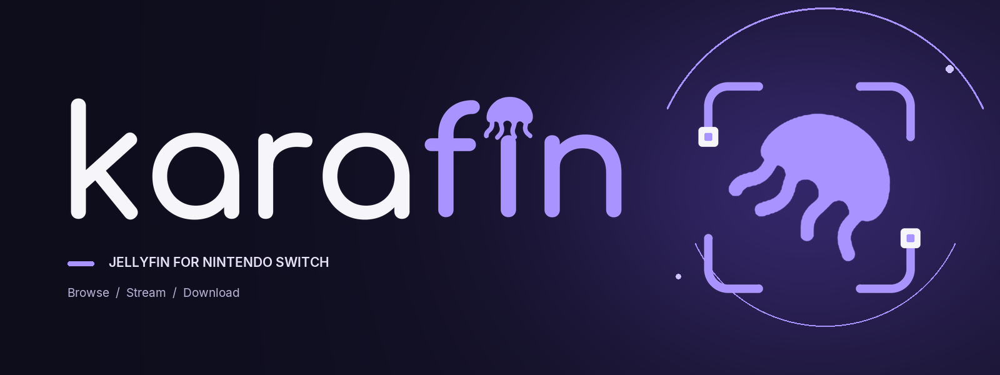
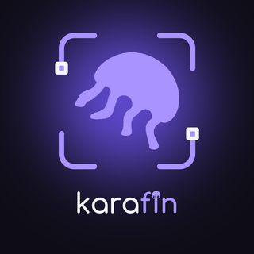

<p align="center">
  
</p>
<p align="center">
  <a href="https://github.com/Doomtrain14/karafin/releases/latest"></a>
  <a href="LICENSE"></a>
  
</p>

Karafin is a [Jellyfin](https://jellyfin.org) client for the Nintendo Switch, written in C++20.
It runs as a homebrew `.nro` on Atmosphère and is built with current libnx for firmware 22.

It has its own GPU-accelerated interface (OpenGL ES 3, 60 fps animations, spatial focus
navigation, touch scrolling) and an mpv-based player with hardware decoding. You can direct play
your files, pick and download subtitles, and download movies and episodes to the SD card for
offline viewing with pause and resume.

> Karafin is an early release. If something goes wrong, please
> [open an issue](https://github.com/Doomtrain14/karafin/issues) and attach the log file (see
> [Troubleshooting](#troubleshooting)).

## Contents

- [Features](#features)
- [Install](#install)
- [Jellyfin server requirements](#jellyfin-server-requirements)
- [Controls](#controls)
- [Settings](#settings)
- [SD card format](#sd-card-format-exfat-recommended)
- [Troubleshooting](#troubleshooting)
- [Building](#building)
- [License and credits](#license-and-credits)

## Features

- **Servers and accounts**
  - LAN server discovery, or enter an address.
  - Several servers and users, remembered between launches. Each Switch profile remembers its
    own last Jellyfin sign-in; the first time a Switch profile is used, it starts with the
    previously used account.
  - Sign in with a password (system keyboard) or Quick Connect.
- **Browsing**
  - Home: a hero carousel, Continue Watching, Next Up, Recently Added per library, and your
    libraries.
  - Library grids with sorting, filters, genres and A-Z jump.
  - Movie, series, season and episode pages with cast, similar titles, and audio, subtitle and
    version pickers.
  - Search, favorites, and marking items watched or unwatched.
  - Long summaries open in full with A (or a tap) on detail and series pages.
  - Profile code: a profile can ask for its D-pad code before it opens, from the account
    picker or at startup. Profiles with a code show a lock.
  - Library lock: press X on a library in the Libraries tab and choose **Lock library** to lock it with a D-pad code of 4 or
    6 steps. A locked library needs the code to open and its titles are left out of Home and
    Search. Unlocking opens that one library until you lock it again (X menu on its tile, the lock
    button on its page, or **Lock now**) or restart the app. Locked titles are also left out of
    actor, genre and collection grids. The code pad also has touch arrows. This is a convenience
    lock inside Karafin, not real security: the server account can still see everything, and Favorites,
    Downloads and "More like this" are not filtered.
  - Administrators can ask the server to scan a library for new files: **Scan library** in a tile's X menu, the
    refresh button on a library page, or **Scan all libraries** in Settings > Account. Each scan
    asks for confirmation first.
- **Playback**
  - Direct play of mkv/mp4/webm/avi/ts with H.264, HEVC (8- and 10-bit), VP8/VP9 and MPEG-2/VC-1
    decoded in hardware (NVDEC). AV1 is decoded in software, up to 1080p.
  - Audio: AAC, AC-3, E-AC-3, FLAC, MP3, Opus, Vorbis, DTS and TrueHD (downmixed by mpv).
  - The server transcodes to HLS only when a file can't be direct played.
  - Resume or start over, synced with your other Jellyfin clients.
  - Trickplay thumbnails while seeking (Jellyfin 10.9+).
  - Skip intro, recap and credits (Jellyfin 10.10+ media segments), and up-next autoplay for
    episodes.
  - Chapters, playback speed, aspect ratio and zoom, and a playback info overlay.
  - Stream tags on the controls: Direct Play, Direct Stream or Transcoding, plus resolution and
    the video and audio codecs.
  - Handheld touch gestures: swipe vertically on the left for screen brightness or on the
    right for playback volume, with on-screen level indicators.
  - Movie or series logo in the upper-left player controls, when provided by the server.
- **Subtitles**
  - Embedded and external tracks (SRT, ASS/SSA, VTT, PGS, DVD).
  - The preferred language and mode (default, always, forced only, off) are picked automatically.
  - Size, position, delay and background box settings.
  - **Download missing subtitles** from the player, through your server's subtitle providers
    (for example the OpenSubtitles plugin). They are added without restarting playback.
- **Downloads**
  - Download a movie, an episode, a season or a whole series. The original file is downloaded,
    with its external subtitles, artwork and metadata.
  - Pause and resume each download or all of them. Downloads resume with HTTP Range requests,
    including after you restart the app, and retry with backoff when the network drops.
  - Downloads are crash-safe: after a power cut a download resumes from the last data known to
    be on the card.
  - Free-space checks. Files over 4 GB also work on FAT32 cards (see
    [SD card format](#sd-card-format-exfat-recommended)).
  - Offline library and playback. Watch progress is synced back to the server when it is
    reachable again.
  - The download list shows each movie's, show's and episode's summary, and the header shows the
    overall speed and the time left.
  - The console never auto-sleeps while something is downloading. **Keep screen on** (the sun
    button on the Downloads tab, or Settings > Downloads) also keeps the screen from dimming.

## Install

1. Download `karafin.nro` from the [latest release](https://github.com/Doomtrain14/karafin/releases/latest)
   and copy it to `sdmc:/switch/karafin/karafin.nro` on your SD card.
2. Launch it from the Homebrew Menu **through title override**: hold **R** while you start any
   installed game, then pick Karafin in the Homebrew Menu.

Title override gives Karafin the full application memory (about 3 GB). If you open the Homebrew
Menu from the Album instead, Karafin runs in **applet mode**. It still starts, but it only has
about 400 MB of memory. In applet mode the image cache and the video cache are smaller, and video
playback, especially high bitrate HEVC, may fail. Karafin shows a warning at startup when it
detects applet mode. You can hide the warning in Settings > Interface.

Karafin keeps its files in `sdmc:/switch/karafin/`:

| Path | Contents |
| --- | --- |
| `settings.json` | settings |
| `log.txt` (and `log.txt.old`) | log file |
| `downloads/` | downloaded media, `queue.json` |
| `cache/` | image cache and subtitle fonts |
| `cacert.pem` | optional: extra CA certificates to trust (self-signed or private CA servers) |

## Jellyfin server requirements

| Feature | Requirement |
| --- | --- |
| Basic use | Jellyfin **10.8** or newer |
| Trickplay thumbnails | Jellyfin **10.9+**, with trickplay images generated for the library |
| Skip intro and credits | Jellyfin **10.10+** media segments, from a segment provider plugin (for example Intro Skipper) |
| Quick Connect | Quick Connect enabled in the server's General settings |
| Downloading subtitles | A subtitle provider plugin (for example **OpenSubtitles**) set up on the server, and the user permission **Allow subtitle management** (administrators always have it) |
| Downloads | The user permission **Allow media downloading** |
| Transcoding fallback | Transcoding allowed for the user (only used when direct play isn't possible) |

Karafin works over HTTP and HTTPS. For a server with a self-signed certificate, add your CA to
`sdmc:/switch/karafin/cacert.pem`, or turn off **Verify server certificates** in
Settings > Interface. Jellyfin 10.11 is supported too: media URLs authenticate with the `ApiKey`
parameter, which works without enabling legacy authorization.

## Controls

The button names below are the Nintendo labels: A is the right face button and B the bottom one.

### Browsing

| Button | Action |
| --- | --- |
| D-pad / left stick | Move focus |
| A | Select |
| B | Back. On a main tab it returns to the tab bar, then to Home, then asks to quit |
| L / R | Switch tabs (and seasons on a series page) |
| X | Actions for the selected item and this page: play, details, mark watched, delete a download, sort, filter, A-Z jump, lock or scan a library |
| + | App menu: jump to a tab, reconnect (offline), controls guide and quit |
| Touch | Tap to select, drag or flick to scroll (handheld mode) |

### Player

| Button | Action |
| --- | --- |
| A | Play/pause. Also confirms a seek preview, presses a visible Skip button, or plays the next episode |
| D-pad ← / → (or stick) | Seek preview. Hold to speed up. It commits on release, or right away with A |
| L / R | Skip back / forward by the **Skip amount** (10 seconds by default). Off by default; turn it on with **Skip with** in Settings > Playback |
| ZL / ZR | Previous / next chapter. Without chapters, skips like L / R when button skipping is on |
| Y | Audio and subtitles, including **Download subtitles** |
| X | Options: speed, subtitle delay, size and position, aspect ratio and zoom, chapters, playback info |
| − | Show or hide the playback info overlay |
| ↑ / ↓ | Show the on-screen controls |
| B | Cancel the seek preview, hide the controls, then leave the player |
| Touch | Tap to show the controls and press on-screen buttons. Drag on the seek bar to scrub |
| Double-tap the left / right side | Skip back / forward by the **Skip amount** (10 seconds by default). Tap again quickly to skip further. This is the default way to skip; change it with **Skip with** |
| Swipe up / down on the left | Raise / lower screen brightness in handheld mode; when docked it changes the volume instead. The original brightness and automatic brightness setting are restored when leaving playback or opening HOME |
| Swipe up / down on the right | Raise / lower playback volume (0-200%, independent of the console's volume buttons; above 100% boosts quiet audio and is shown in amber). Double-tap the volume indicator to reset it to 100% |

For series, the next-episode card appears near the end or during credits and counts down
10 seconds before autoplay. The countdown continues if the episode ends, and waits while
paused, buffering, seeking, in a menu, or away from the app. The card has **Play now** and
**Cancel** buttons: pick one with the D-pad and press A, or tap it. B also cancels autoplay for
this episode. Press ↑ to leave the buttons and seek with ← / →, and ↓ to return to them. Turn off **Autoplay
next episode** in Settings > Playback to keep the card manual-only.

The screen stays on and the console doesn't sleep while a video plays, loads or buffers. When
you pause, the normal dimming and sleep timers apply again.

Pressing HOME pauses playback. If you come back within 30 seconds, playback continues; after
sleep or a longer break it stays paused. If the network drops mid-video (for example after
sleep), the player shows "Reconnecting" and continues where it left off once the connection is
back.

## Settings

Settings are grouped into Account, Playback, Subtitles, Downloads, Interface and About. The most
useful ones:

- **Account**
  - Lock code for the signed-in profile: set or change the D-pad code, **Lock now** (locks every
    unlocked library again), **Ask for code to open this profile**, or turn the code off
    (removes it, every library lock and the profile code). Each profile on each server has its
    own code and locks. After 5 wrong tries the code pad pauses for 30 seconds, longer after
    more failures.
  - **Scan all libraries** (administrators only).
- **Playback**
  - Max streaming bitrate and max audio channels. These decide when the server has to transcode.
  - CPU clock: System, 1428 MHz or 1785 MHz (default 1785 MHz).
  - GPU clock: System, 460 MHz or 768 MHz (default 768 MHz). Docked never goes below 768 MHz.
    The defaults keep animations and 1080p playback smooth, at the cost of battery life and
    a warmer console. "System" hands the clock back to whatever was set when Karafin opened.
    If sys-clk is installed it may reset clocks; Karafin puts them back about once a second.
    Clocks are restored when Karafin exits.
  - Hardware decoding: on by default. Turn it off only to troubleshoot.
  - Preferred audio language, autoplay of the next episode, and skipping of intros and credits
    (ask, automatic or off).
  - Seek step (D-pad), skip amount (default 10 seconds), and whether skipping uses double-tap
    (default), the L / R and ZL / ZR buttons, or both.
- **Subtitles**: mode, preferred language, text size, position and background box.
- **Downloads**
  - Simultaneous downloads: 1 to 4 (default 1).
  - Resume downloads on launch.
  - Keep screen on while downloading (default on).
  - Speed limit while streaming, so downloads don't starve playback.
  - Delete watched downloads.
- **Interface**
  - Show battery: percentage and charge state in the top bar and player controls (on by default).
  - Navigation sounds (on by default; turn off for silent browsing).
  - Image memory.
  - Verify server certificates.
  - Performance overlay: fps, draw calls, image memory.
  - Log level.
  - Hide the applet mode warning.
- **About**: the Karafin and server versions, firmware, launch mode (applet, docked or
  handheld), memory use, library versions with the available hardware decoders, and the device
  ID.

### Hardware decoding

Karafin decodes video on the Switch's NVDEC hardware through FFmpeg's nvtegra decoder
(`hwdec=nvtegra-copy`): decoded frames are copied to memory and uploaded to the GPU. The
bundled libmpv 0.36 has no zero-copy OpenGL path for nvtegra frames, so this is the only
hardware path. AV1, and anything NVDEC can't handle, falls back to software decoding. The
playback info overlay (−) shows which decoder is active, and the video's colour space and HDR
peak. HDR10 video is tone mapped to SDR.

## SD card format: exFAT recommended

FAT32 can't store a plain file of 4 GB or more, and many remuxed movies are bigger than that.
Karafin stores large downloads the way the Switch itself does on FAT32: as a "concatenation file"
(a folder of chunks that the system treats as one file). That makes downloads over 4 GB work on
FAT32 too. If the system refuses to create one, Karafin falls back to a plain file. It then stops
with a message asking you to reformat as exFAT, either right away (when the console has no exFAT
driver, so the card must be FAT32) or when a write fails at the 4 GB limit.

**exFAT** is still the safer choice for large media libraries. The console's system firmware
must include the exFAT driver; if you update with Daybreak, choose the exFAT variant. Keep at
least a few hundred MB free: Karafin keeps a 256 MB safety margin when it checks free space.

## Troubleshooting

- **Log file**: `sdmc:/switch/karafin/log.txt`. The previous one is kept as `log.txt.old`. To see
  more detail, set Settings > Interface > Log level to `debug` and reproduce the problem.
- **Live log over Wi-Fi**: start Karafin with `nxlink -s karafin.nro` from a PC, holding R on a
  game so that the Homebrew Menu's netloader runs with full memory. Log lines then also appear in
  the terminal.
- **Can't find the server**: LAN discovery uses UDP port 7359 broadcasts, which some networks
  block. Enter the address by hand instead, for example `192.168.1.10:8096` or
  `https://jellyfin.example.com`.
- **Video stutters or won't play**:
  - Check the playback info overlay (−). It shows whether the file is direct played or transcoded,
    and which decoder is in use.
  - If you're running in applet mode, relaunch through title override.
  - Lower the max streaming bitrate to make the server transcode very high bitrate files.
- **"Download subtitles" finds nothing or is refused**: the server needs a subtitle provider
  plugin, and your user needs subtitle permission (see the requirements above).
- **Downloads are refused**: enable **Allow media downloading** for your user in the Jellyfin
  dashboard.
- **The app closes while loading posters**: a damaged image cache can cause this. Delete
  `sdmc:/switch/karafin/cache/` and start Karafin again; the cache is rebuilt automatically.
- **After waking from sleep**: Karafin drops its old server connections and reconnects
  automatically. Downloads continue once the Wi-Fi connection is back. A download that was
  mid-transfer can take up to a minute to notice that its connection died.

## Building

Requirements: Windows with PowerShell 7, and Docker Desktop **or** Podman (a `podman machine`
WSL distro). Everything that is downloaded or generated stays in `./build`.

```powershell
./build.ps1            # incremental Release build -> build/out/karafin.nro
./build.ps1 -Clean     # clean rebuild (keeps the package and header caches)
./build.ps1 -BuildType Debug
```

The script:

1. Fetches the pinned devkitPro and Switchfin portlibs packages (FFmpeg with the nvtegra
   decoder, libmpv 0.36) into `build/pkgs`, and verifies their SHA-256 checksums.
2. Builds the `karafin-builder` image (devkitA64 + libnx + portlibs).
3. Configures and builds with CMake and Ninja inside the container.

If Docker isn't running, it uses rootful Podman in the `podman-machine-default` WSL distro.

Host-side unit tests of the pure logic (the Jellyfin models and URL builders, the download queue
and range/resume helpers) run on Linux with GCC 14:

```powershell
./tools/host-tests.ps1
```

Source layout and module documentation start at [`src/README-ARCH.md`](src/README-ARCH.md).

### Brand artwork

<p align="center">
  
</p>

The Open Frame icon is a jellyfish inside a framed viewfinder, on the same violet glow as
Karastream's icon. The "karafin" wordmark uses the same font size, stroke and spacing as
Karastream's, and a small jellyfish holds the stem of the "i". The app draws the wordmark from an
image wherever the name appears: the header, the server screen, the + menu and Settings > About.

All brand artwork is generated from `tools/jelly_source.png` (the jellyfish silhouette) and the
Comfortaa fonts in `tools/fonts` (SIL Open Font License):

| File | Used for |
| --- | --- |
| `tools/icon_source.png` | 1024x1024 icon master (glow background, frame, jellyfish, wordmark) |
| `assets/icon.jpg` | 256x256 NRO icon shown in the Homebrew Menu |
| `docs/images/icon.png` | README icon |
| `docs/images/banner-open-frame.png` | README banner |
| `romfs/frame.png`, `romfs/jelly.png` | Splash screen: the frame and the swimming jellyfish |
| `romfs/wordmark.png` | Light wordmark for dark backgrounds |
| `romfs/wordmark-ink.png` | Dark (ink) wordmark for focused, light rows |
| `src/screens/brand_art.hpp` | Generated layout constants for the splash and wordmark |

Run `python tools/make_brand.py` (requires Pillow, NumPy and SciPy) to regenerate everything except
the banner. `python tools/gen_icon.py` alone regenerates only the two icons from
`tools/icon_source.png`.

## Contributing

Bug reports and pull requests are welcome. For a bug, include your Switch firmware and Atmosphère
versions, your Jellyfin server version, and `log.txt`. Before sending a pull request, make sure
`./build.ps1` builds without warnings and `./tools/host-tests.ps1` passes.

## License and credits

Karafin is released under the [GNU General Public License v3.0](LICENSE). It is not affiliated with
Jellyfin or Nintendo.

The release `.nro` links FFmpeg and mpv statically. The pinned FFmpeg package is configured with
`--enable-gpl --enable-version3` (GPL-3.0-or-later) and libmpv is built with its `gpl` option
(GPL-2.0-or-later), so the combined binary is distributed under GPL-3.0. Release binaries must come
with the matching source, which means tagging the commit each release is built from.

Karafin uses SDL2, mpv, FFmpeg (with averne's nvtegra hardware decoder), libass, libcurl, mbedtls,
FreeType, HarfBuzz, libwebp, nlohmann/json and stb_image. The bundled Inter font and the Comfortaa
font used for the wordmark artwork are licensed under the SIL Open Font License. The prebuilt
FFmpeg/mpv Switch packages come from the
[Switchfin](https://github.com/dragonflylee/switchfin) project.
